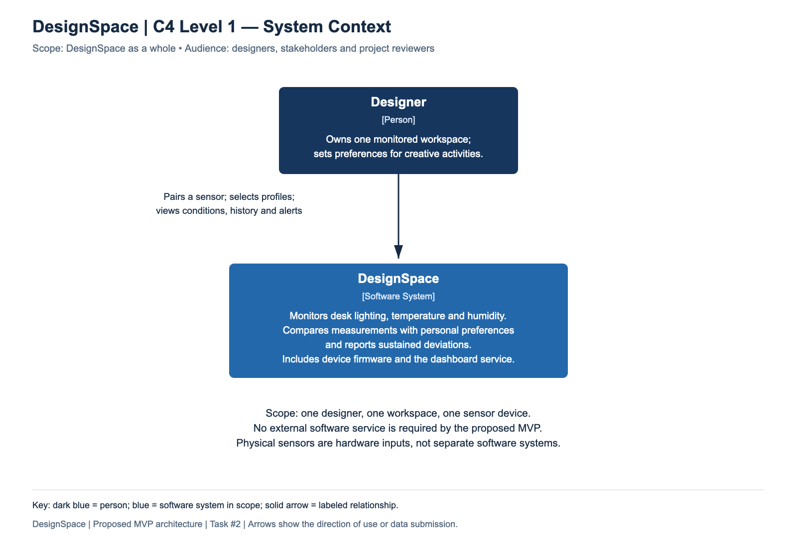
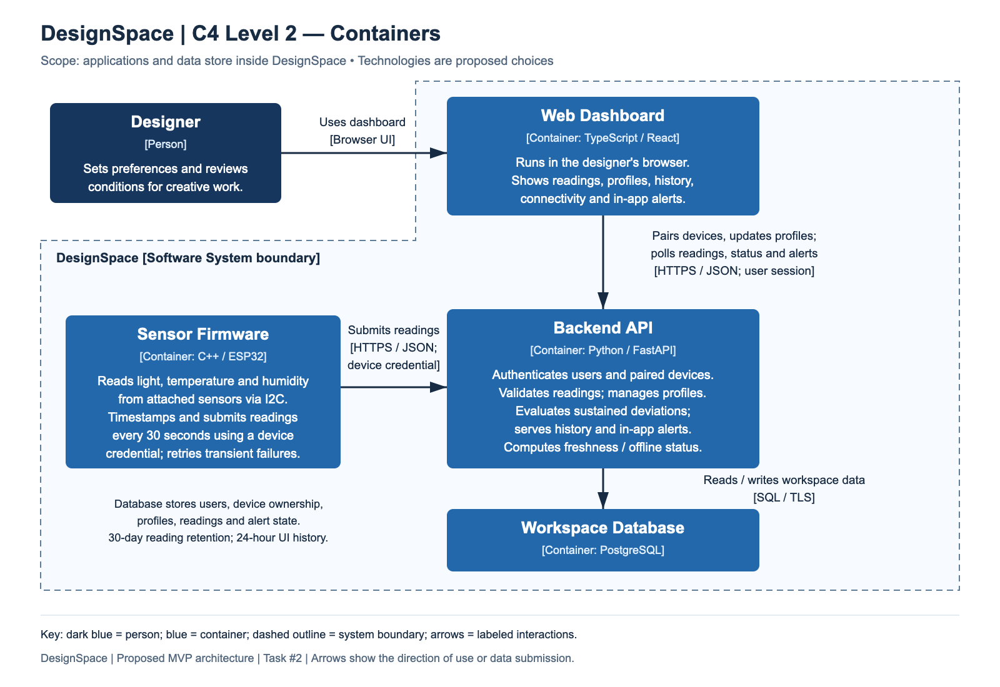

# DesignSpace — Smart Workspace for Designers

An IoT project for designers who want to understand and reproduce their preferred workspace conditions.

A desk-mounted sensor measures ambient light, temperature, and humidity. A dashboard shows current and historical readings, supports personal profiles for different creative activities, and provides in-app alerts when conditions remain outside the selected ranges.

## Project status

Business context, C4 architecture, and Docker-based MQTT infrastructure are available. The sensor firmware, backend application, and dashboard remain planned.

## Documentation

- [Task #1 — Business context description](BUSINESS_CONTEXT.md): business problem, stakeholders, objectives, scope, five use cases, eight user stories, acceptance criteria, business rules, risks, and validation plan.
- [Task #2 — C4 architecture](docs/architecture/README.md): System Context and Container diagrams, proposed technologies, and architecture decisions.

- [Task #3 — MQTT broker infrastructure](infrastructure/mqtt/README.md): Docker setup, TLS, authentication, topic permissions, simulator, and integration checks.

## C4 architecture diagrams

These images capture the Task #2 proposal. Task #3 replaces device-to-API HTTPS ingestion with an MQTT broker and backend subscriber; see the infrastructure documentation for the updated flow.

### System Context

### Containers

