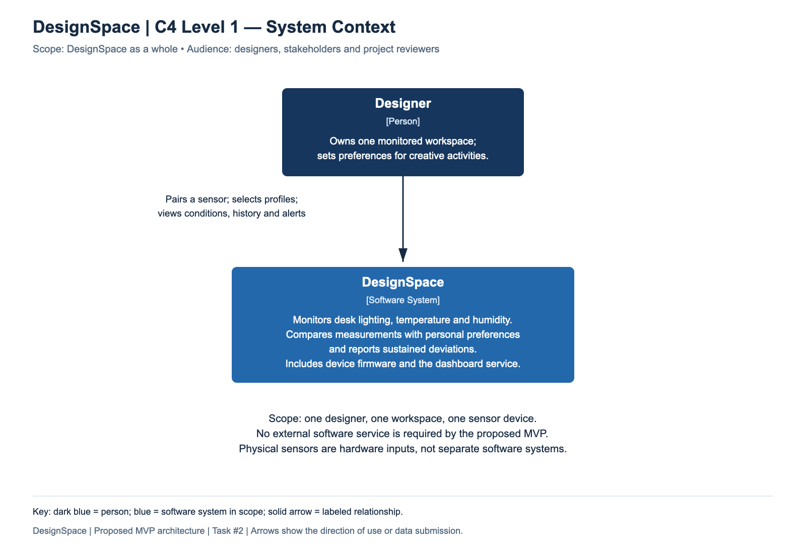
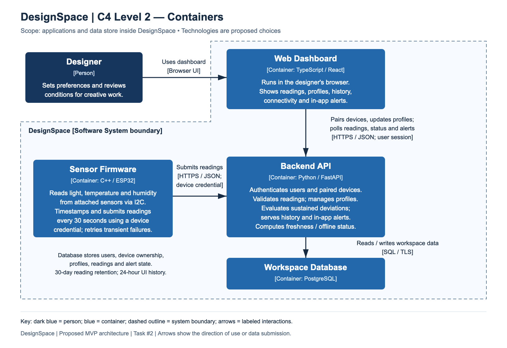

# Task #2 — C4 Architecture

Proposed architecture for **DesignSpace — Smart Workspace for Designers**. These diagrams describe the planned MVP, not existing deployed software.

## System Context — Level 1



[SVG image](system-context.svg)

DesignSpace is the system in scope. The designer pairs a sensor, selects activity profiles, and reviews readings, history, and alerts. Device firmware belongs to DesignSpace, so it is not modeled as an external system. The MVP has no external software-service dependency. Physical sensors provide inputs to firmware; they are not independent software systems.

## Containers — Level 2



[SVG image](container.svg)

The dashed boundary includes all four containers, including the dashboard executing in the user's browser. In C4, a container is an application or data store, not necessarily a Docker container.

| Container | Proposed technology | Responsibility |
| --- | --- | --- |
| Sensor Firmware | C++ on ESP32 | Read attached sensors through I2C and submit timestamped readings every 30 seconds over authenticated HTTPS. |
| Web Dashboard | TypeScript / React | Pair devices, manage activity profiles, and display readings, 24-hour history, status, and in-app alerts. |
| Backend API | Python / FastAPI | Authenticate users and devices, enforce ownership, validate and deduplicate readings, manage profiles, evaluate deviations, and serve dashboard data. |
| Workspace Database | PostgreSQL | Persist users, device ownership and credential verifiers, profiles, readings, and alert state; retain readings for 30 days. |

These technologies are design proposals resolving the options left open in Task #1; hardware models and sensor accuracy still require validation. Firmware is shown as an application running on the device, not as the physical device itself.

## Communication and business rules

1. The designer interacts with the browser dashboard. The dashboard uses HTTPS/JSON with a user session to call the backend; proposed polling is every 15 seconds while open.
2. Firmware submits readings over HTTPS/JSON with a per-device credential. The backend checks device ownership, units, timestamps, and unique reading identifiers.
3. The backend persists accepted readings and evaluates five-minute sustained deviations against the active profile. Evaluation and persistence are transactional; duplicate or historical readings cannot advance current alert state.
4. Gaps longer than 60 seconds reset pending deviation timers. Profile changes reset evaluation. Returning to range resolves an active condition. The database preserves alert state across backend restarts.
5. The API derives offline status from the last fresh reading's receipt time when serving dashboard requests. Five minutes without a valid fresh reading means offline. This does not require a separate monitoring service.
6. Alerts are stored and retrieved in-app through the dashboard API; there is no email, SMS, or push provider. Database access uses SQL over TLS. Arrow direction denotes the caller or data sender; responses are implicit.
7. A scheduled maintenance task in the backend runtime deletes readings older than 30 days. It is an internal implementation responsibility, not a separate deployable container in this MVP.

User authentication is handled by the backend; an external identity provider is not assumed. Automatic equipment control, display calibration, and shared studio accounts remain outside scope.

## Sources and regeneration

The abstraction levels follow the official [C4 System Context guidance](https://c4model.com/diagrams/system-context) and [C4 Container guidance](https://c4model.com/diagrams/container). Each image includes a title, scope, element types, descriptions, labeled directed relationships, and a key. The container view adds technologies, protocols, and the system boundary.

The editable SVG images can be regenerated with Python 3 using only the standard library:

```bash
python3 docs/architecture/generate_diagrams.py
```

PNG files are raster exports of the SVG images. Export the full SVG canvas in an SVG-capable image tool when updating them. The committed PNG images are 1600 × 1100 pixels.
