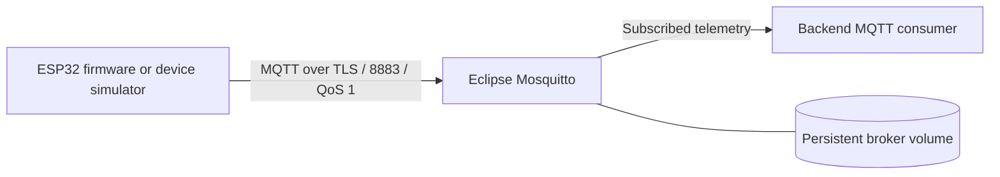

# Task #3 — DesignSpace MQTT broker infrastructure

Docker-based Eclipse Mosquitto broker for DesignSpace sensor telemetry. The setup includes TLS, generated credentials, topic access rules, persistent broker storage, a health check, a device simulator, and executable integration checks.

## Architecture



This task changes the proposed device ingestion transport from Task #2: **device → MQTT broker → backend consumer** replaces direct device-to-API HTTPS submissions. The browser-to-API connection remains HTTPS. The backend consumer, database, and user dashboard are not implemented by this infrastructure task; the supplied listener demonstrates the consumer connection.

The course reference has moved from `6-paas-iot-hub` to [6-paas-iot-mqtt](https://github.com/lsawicki-cdv/course-iot-cloud-computing/tree/main/6-paas-iot-mqtt). This implementation follows its Docker/Mosquitto and simulated-device approach, with authenticated TLS and topic isolation added. It does not require Azure resources.

## Prerequisites

- Docker Engine and Docker Compose (Docker Desktop or Colima on macOS).
- Python 3 and OpenSSL for local credential/certificate generation.
- TCP port 8883 available on localhost.

For Homebrew on macOS:

```bash
brew install colima docker docker-compose
colima start --cpu 2 --memory 2 --disk 10 --vm-type vz
```

The commands below use the standalone `docker-compose` executable installed by Homebrew. On Docker Desktop, use `docker compose` in its place.

## Create and start the broker

From the repository root:

```bash
cd infrastructure/mqtt
./setup.sh
docker-compose config --quiet
docker-compose up -d --wait broker
docker-compose ps
```

Setup creates a development CA, a one-year server certificate for `broker`, `localhost`, and `127.0.0.1`, random passwords, and a Mosquitto password hash file. All generated material stays in ignored `secrets/`. Re-running setup refuses to overwrite existing credentials. The private CA key and client credentials are host-private; broker-readable files are protected by the enclosing host directory's permissions.

The broker listens on **localhost:8883**, with TLS 1.2 or later. Anonymous connections and plain MQTT on port 1883 are disabled. Docker clients connect to `broker:8883` on the Compose network. A certificate-trusting host client can use `localhost:8883`.

## Verify the infrastructure

```bash
docker-compose --profile tools run --build --rm client test
```

The test checks:

- Anonymous and invalid-password connections are rejected.
- A device's QoS 1 message reaches the subscribed backend over verified TLS.
- Publishing under another device's topic is rejected.
- The backend cannot publish telemetry.
- A write-only device cannot receive telemetry.

Expected final line: `ALL MQTT CHECKS PASSED`. The process exits nonzero on failure.

Run a listener in one terminal:

```bash
docker-compose --profile tools run --rm client listen
```

Run the simulator in another:

```bash
docker-compose --profile tools run --rm client simulate
```

The simulator sends explicitly labeled simulated readings every 30 seconds. Stop either client with Ctrl+C. The listener is a demonstration, not the future production consumer.

## Topics, credentials, and payload

| Account | Permission |
| --- | --- |
| `device-01` | Publish only to `designspace/workspaces/studio-01/devices/device-01/telemetry`. |
| `backend` | Read `designspace/workspaces/studio-01/devices/+/telemetry`. |
| `health` | Read only `$SYS/broker/version` for readiness. |

Passwords are generated independently and stored locally in `secrets/clients.json`; never paste them into Git or the documentation. Additional devices need their own credentials and explicit ACL entries. This MVP provisions a single workspace and sensor, matching the business scope.

Example JSON:

```json
{
  "reading_id": "4da14c22-c449-4bdd-b037-5677c3b50b68",
  "device_id": "device-01",
  "workspace_id": "studio-01",
  "measured_at": "2026-11-17T15:00:00+00:00",
  "illuminance_lux": 520.0,
  "temperature_c": 22.4,
  "humidity_percent": 45.0,
  "simulated": true
}
```

QoS 1 is at-least-once delivery: the future consumer must deduplicate by `reading_id`, validate values and timestamps, and use topic ownership rather than trusting payload identity. Telemetry is not retained, preventing a new subscriber from interpreting an old retained reading as live. This demo uses clean client sessions, so messages published while the consumer is offline are not guaranteed to be delivered later. Durable consumer sessions and device buffering are future integration work.

## Operations

```bash
docker-compose logs --tail 100 broker
docker-compose restart broker
docker-compose stop broker       # stop, keep container and stored data
docker-compose up -d --wait broker
docker-compose down             # remove containers/network, keep data volume
```

The named `broker-data` volume survives container recreation. It stores broker session state when durable clients are used; it is not a telemetry history database. Logs are rotated at 5 MB, with three files retained.

`docker-compose down -v` also deletes broker storage; use only for a deliberate reset. Generated credentials remain until you remove `secrets/`. Certificate renewal requires replacing the server certificate/key and restarting the broker. To rotate all development credentials, stop the stack, move the existing `secrets/` directory to a secure backup outside the repository, run setup again, and recreate the broker and clients. Existing devices must receive the new CA/credentials.

The default bind is local-only. Connecting physical hardware over a LAN requires an explicit network binding change, a server certificate containing the host's LAN DNS name/IP, and firewall configuration. Do not disable TLS verification. This is a single-host development broker, with no high availability or cloud deployment.

## References

- [Course MQTT exercise](https://github.com/lsawicki-cdv/course-iot-cloud-computing/tree/main/6-paas-iot-mqtt)
- [Official Mosquitto authentication documentation](https://mosquitto.org/documentation/authentication-methods/)
- [Mosquitto Docker source and configuration guidance](https://github.com/eclipse-mosquitto/mosquitto/tree/master/docker)

The broker image uses an explicit 2.0.22 release tag to match the file-based authentication configuration. Review upstream releases before production deployment; upgrades to a new major/minor configuration model require retesting.

## Recorded validation

See [VALIDATION.md](VALIDATION.md) for the completed local runtime checks and their limits. The broker was started and tested, including a restart and host-side certificate validation.
